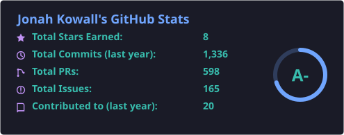
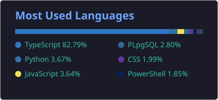
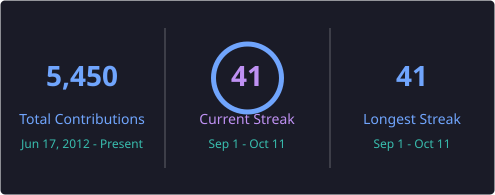

# 👋 Hi, I'm Jonah Kowall

### SVP of Product and Design at [Spacelift](https://spacelift.io)

---

## 💼 About Me

I'm SVP of Product and Design at [Spacelift](https://spacelift.io), an infrastructure-as-code orchestration company, in Pompano Beach, FL. I own product direction across Deploy, Flows, and Spacelift Intelligence.

Before Spacelift I was at Paessler, Aiven, and Kentik, and I was CTO at Logz.io. At AppDynamics I worked through the S-1, the IPO, and the Cisco acquisition. At Gartner I led the APM Magic Quadrant, created the NPMD Magic Quadrant, and coined the term "Network Packet Broker."

I maintain [Jaeger](https://github.com/jaegertracing/jaeger). I was on the founding team of [OpenSearch](https://github.com/opensearch-project/OpenSearch) and sit on its technical steering committee. I have run product, design, and engineering teams of 100+ people, and I still do technical work.

I scuba dive reefs and wrecks and take underwater photos. The code for that is in [underwater-photo-processing](https://github.com/jkowall/underwater-photo-processing), [Barefoot-Dive](https://github.com/jkowall/Barefoot-Dive) (dive planning), and [Barefoot-Blender](https://github.com/jkowall/Barefoot-Blender) (gas blending).

---

## 🏗️ Infrastructure as Code

At Spacelift I work on how teams run OpenTofu, Terraform, Pulumi, Ansible, and Kubernetes at scale: orchestration, policy, drift, and observability for IaC runs. At AWS re:Invent this year I'm talking about tracing `tofu apply`.

---

## 🌟 Notable Projects

### [Jaeger](https://github.com/jaegertracing/jaeger) - CNCF Distributed Tracing Platform
 | Open source, end-to-end distributed tracing platform

Maintainer; I review PRs and help shape the roadmap and releases.

### [OpenSearch](https://github.com/opensearch-project/OpenSearch)
 | Open source distributed search and analytics engine

Member of the technical steering committee and part of the founding team.

### [OpenTelemetry Collector](https://github.com/open-telemetry/opentelemetry-collector) - CNCF Observability Framework
 | Vendor-neutral observability framework

Community participant and contributor since the early days.

### [Jaeger UI](https://github.com/jaegertracing/jaeger-ui)
 | Web interface for Jaeger distributed tracing

Maintainer on the Jaeger web UI.

---

## 🛠️ Tech Stack

| Category | Technologies |
|---|---|
| 🏗️ **Infrastructure as Code** | OpenTofu, Terraform, Pulumi, Ansible, CloudFormation |
| 💻 **Languages** | Go, Java, JavaScript/TypeScript, Python |
| ☁️ **Platforms** | Kubernetes, Docker, AWS, Azure, Google Cloud, Oracle Cloud |
| 🔭 **Observability** | Jaeger, OpenTelemetry, Prometheus, Grafana, Thanos |
| 🔍 **Search** | OpenSearch, Elasticsearch |
| 🗄️ **Databases** | PostgreSQL, Cassandra, ClickHouse, Redis |
| 🛠️ **Tools** | Git, CI/CD, Helm |

---

## 📊 GitHub Stats

---

## 🤝 Let's Connect!

I'm always interested in discussing:
- 🏗️ Infrastructure as code and platform engineering
- 💡 Observability and monitoring strategies
- 🌐 Open source collaboration opportunities
- 🚀 Cloud-native architectures
- 📈 Technology leadership and team building

Feel free to reach out via [X](https://x.com/jkowall), [LinkedIn](https://linkedin.com/in/jkowall), or [email](mailto:jkowall@kowall.net)!

---

